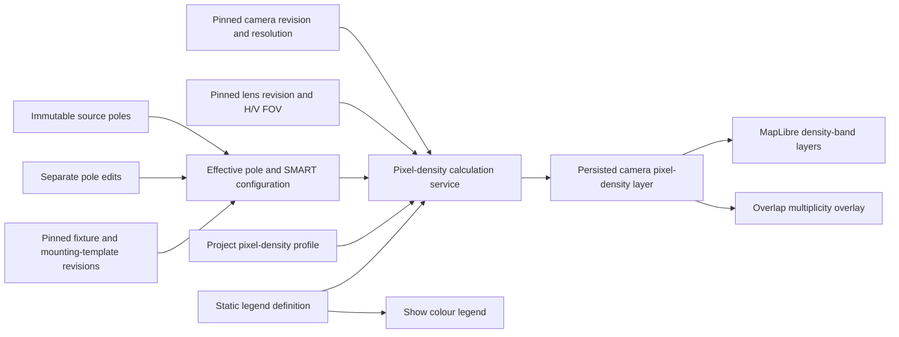

# BL-016 Camera Pixel-Density Map — Architecture and Data Model

Date: 2026-09-16

Status: approved architecture and data-model direction; implementation remains separately gated

Scope: BL-016 / WA-09 only

## 1. Purpose

BL-016 adds a deterministic camera pixel-density colour map to the existing fixed-camera geometry workflow. The map communicates horizontal image density as **pixels per face** for a fixed reference face width of **0.16 m**.

The feature is geometric and informational. It must not be described as detection, recognition, identification, analytics performance, unobstructed visibility, or compliance evidence.

This document records the agreed architecture and proposed persisted data structure. It does not authorize implementation, schema migration, merge, push, or a new numbered phase.

## 2. Approved product rules

- Each enabled camera is calculated independently from its pinned camera revision, pinned lens revision, mounting template, pole height, fixture azimuth, fixed relative camera azimuth, and fixed downward tilt.
- The camera model supplies image resolution. The lens supplies horizontal and vertical field of view.
- Density is expressed horizontally as `px/face`, using a fixed face width of `0.16 m`.
- The project owns an editable lower projection plane, upper projection plane, and maximum visible distance.
- Defaults are:
  - lower projection plane: `0.5 m` above local ground;
  - upper projection plane: `2.0 m` above local ground;
  - maximum visible distance: `50.0 m` from the camera origin.
- AUTO measurement height is the midpoint between the lower and upper planes. With the defaults, it is `1.25 m`.
- The project uses one fixed, static legend. The legend is not edited per camera, lens, pole, or project.
- The fixed density thresholds are `2`, `3`, `5`, `7`, `10`, `15`, `20`, `30`, `45`, and `70 px/face`.
- Legend rows display only colour and `px/face`. Labels such as Detection or Face Recognition are excluded.
- Different cameras may produce differently shaped and positioned bands because their resolutions, lenses, heights, and orientations differ. Their colours still have identical meanings.
- No colour is rendered outside the configured maximum distance. The outer visible class uses the legend's lowest light-cyan band; the map is transparent beyond the valid projection envelope or distance cap.
- In an overlap, densities are not added. The base colour is selected from the highest density available at that location.
- Overlap remains visible through a separate sparse-dot and dashed-outline overlay with a `2×`, `3×`, or higher multiplicity label.
- Selecting an overlap location exposes every camera covering that location.

## 3. Architectural placement

BL-016 extends the existing Phase 3 camera pipeline without changing source poles, pole edits, catalog history, or the accepted ground-footprint result.



The backend remains the authoritative calculation owner. The frontend renders backend-produced vector geometry and does not independently calculate engineering density values.

## 4. Component boundaries

The proposed implementation keeps each responsibility isolated:

- **Project models** define the project-level profile and the derived result contracts.
- **Camera catalog models** remain the authority for pinned resolution and lens FOV. Resolution or FOV values are never copied into editable user settings.
- **Camera geometry service** remains responsible for the accepted flat-ground footprint and its existing provenance.
- **Pixel-density calculation service** consumes effective camera geometry inputs and produces deterministic, mutually exclusive vector bands plus overlap regions.
- **Freshness/invalidation logic** compares a calculation-input fingerprint with current project and catalog-revision inputs.
- **Map rendering** converts persisted projected/WGS84 rings into ordered MapLibre fill and line layers.
- **Legend UI** reads the static legend definition and exposes it through the top-level **Show colour legend** action.
- **Point inspection** queries rendered density and overlap features and reports all covering camera identities.

The density service should be a separate unit rather than being embedded in the React map component or mixed into the existing ground-footprint function. This preserves deterministic backend ownership and allows geometry tests without a browser.

## 5. Layer separation

The existing repository separation remains mandatory:

| Data category | BL-016 representation | Mutation rule |
|---|---|---|
| Customer source | Existing `source.poles` and immutable upload | Never modified |
| User configuration | Existing pole edits plus project pixel-density profile | Explicit edits only |
| Catalog evidence | Pinned camera, lens, fixture, and mounting revisions | Immutable revision lookup |
| Existing calculated geometry | Existing `camera_geometry` footprints and overlap summaries | Preserved as a separate accepted result |
| New calculated data | Dedicated `camera_pixel_density` derived layer | Reproducible and replaceable; never treated as source |
| Presentation | Static legend and MapLibre style tokens | No engineering values calculated in the browser |

BL-016 must not replace or reinterpret the existing `CameraFootprintResult.pixel_density.method = "not-calculated"` seam until an explicitly approved schema migration defines the compatibility transition.

## 6. Project-level configuration

The proposed project-owned settings object is:

```json
{
  "camera_pixel_density_profile": {
    "lower_projection_height_m": 0.5,
    "upper_projection_height_m": 2.0,
    "measurement_height_mode": "midpoint",
    "maximum_visible_distance_m": 50.0,
    "legend_id": "face-density-0.16m-v1"
  }
}
```

### Field semantics

- `lower_projection_height_m` is the lower horizontal plane above the application's local ground plane.
- `upper_projection_height_m` is the upper horizontal plane above the same ground plane.
- `measurement_height_mode` is fixed to `midpoint` for the first version.
- Effective measurement height is derived as:

  ```text
  measurement_height_m =
      (lower_projection_height_m + upper_projection_height_m) / 2
  ```

- `maximum_visible_distance_m` is a hard rendering and calculation-envelope cap measured horizontally in the project CRS from the camera origin.
- `legend_id` references the application-owned static legend. Thresholds, face width, and colours are not copied into editable project settings.

### Validation invariants

- All numeric values must be finite.
- `0 <= lower_projection_height_m < upper_projection_height_m`.
- `maximum_visible_distance_m > 0`.
- The selected projected CRS must be a metre-based engineering CRS.
- The derived midpoint must remain strictly between the lower and upper planes.

## 7. Static legend definition

The legend is application-owned reference data, not mutable project data. Its conceptual contract is:

```json
{
  "id": "face-density-0.16m-v1",
  "metric": "horizontal-pixels-per-object",
  "display_units": "px/face",
  "object_width_m": 0.16,
  "thresholds_px_per_face": [2, 3, 5, 7, 10, 15, 20, 30, 45, 70],
  "labels": "density-values-only",
  "editable": false
}
```

The exact colour tokens are centralized with this legend version and follow the approved reference palette, from the outer light-cyan class through the higher-density green, yellow, orange, red, and magenta classes. Hex values must be locked in the detailed engineering contract and verified visually before implementation; they must not be invented separately by backend and frontend code.

## 8. Derived result structure

The proposed top-level result is a separate project collection:

```json
{
  "camera_pixel_density": {
    "model_version": "camera-face-density-vector-1.0.0",
    "calculated_at": "2026-09-16T00:00:00Z",
    "projected_crs": "EPSG:32617",
    "calculation_input_sha256": "<64 lowercase hexadecimal characters>",
    "profile_snapshot": {
      "lower_projection_height_m": 0.5,
      "upper_projection_height_m": 2.0,
      "measurement_height_m": 1.25,
      "maximum_visible_distance_m": 50.0,
      "legend_id": "face-density-0.16m-v1",
      "face_width_m": 0.16
    },
    "camera_results": [],
    "overlap_regions": [],
    "warnings": [],
    "assumptions": [],
    "disclaimer": "Geometric pixel density only; not detection, recognition, analytics, occlusion, or compliance evidence."
  }
}
```

The profile snapshot makes every result auditable even if project settings later change. A mismatch between the snapshot/fingerprint and current inputs makes the result stale and prevents it from being displayed as current.

## 9. Per-camera result

Each enabled, valid camera produces one independent result:

```json
{
  "footprint_id": "<pole-id>/<camera-slot-id>",
  "pole_id": "<pole-id>",
  "camera_slot_id": "camera-1",
  "fixture_model_id": "<fixture-model-id>",
  "fixture_model_revision": 1,
  "mounting_template_revision": 1,
  "geometry_contract_version": "fixed-zero-origin-1.0.0",
  "camera_model_id": "camera-imx477",
  "camera_model_revision": 1,
  "lens_id": "lens-jl-ln039",
  "lens_revision": 1,
  "resolution_width_px": 4056,
  "resolution_height_px": 3040,
  "horizontal_fov_deg": 52.0,
  "vertical_fov_deg": 40.0,
  "fixture_height_m": 10.0,
  "camera_absolute_azimuth_deg": 90.0,
  "fixed_downward_tilt_deg": 35.0,
  "valid": true,
  "projection_envelope": {
    "projected_rings_m": [],
    "wgs84_rings": []
  },
  "bands": [],
  "warnings": [],
  "assumptions": []
}
```

The catalog values above are result provenance, not editable copies. The current catalog's IMX477 resolution (`4056 × 3040`) and its available lens FOVs (`52° × 40°`, `69° × 54°`, and `87° × 68°`) are examples of revision-pinned inputs; the architecture supports additional valid revisions without changing the legend.

## 10. Density-band structure

Each per-camera result contains ordered, mutually exclusive vector bands:

```json
{
  "band_id": "px-face-30",
  "legend_id": "face-density-0.16m-v1",
  "rank": 8,
  "minimum_px_per_face": 30.0,
  "maximum_px_per_face": 45.0,
  "display_value_px_per_face": 30.0,
  "colour_token": "face-density-30",
  "projected_rings_m": [],
  "wgs84_rings": [],
  "area_m2": 0.0
}
```

Band rules:

- The polygons are calculated in the project-selected projected CRS.
- WGS84 copies exist only for display/interchange.
- Bands do not overlap within one camera result.
- The highest threshold is open-ended (`70 px/face` and above).
- The outermost visible region is clipped by the configured maximum distance and the valid camera projection envelope.
- Empty bands may be omitted from `bands`, while the legend remains complete and unchanged.
- Polygon ordering and coordinate rounding must be canonical so identical inputs produce identical serialized geometry and fingerprints.

## 11. Overlap structure and compositing

Overlap is stored separately from camera bands so density meaning is not corrupted by camera count.

```json
{
  "overlap_region_id": "<deterministic-id>",
  "camera_footprint_ids": ["pole-a/camera-1", "pole-b/camera-2"],
  "multiplicity": 2,
  "winning_camera_footprint_id": "pole-a/camera-1",
  "winning_band_id": "px-face-30",
  "projected_rings_m": [],
  "wgs84_rings": [],
  "area_m2": 0.0
}
```

Rendering order is deterministic:

1. Render per-camera density bands.
2. At shared locations, display the colour of the highest-density contributing camera.
3. Render the overlap treatment above the colour: dashed outline, sparse dots, and multiplicity label.
4. On selection, list every contributing camera and identify the camera supplying the visible density colour.

No sum, average, or synthetic combined density value is created.

## 12. Fingerprint and invalidation

`calculation_input_sha256` must be calculated from canonical JSON containing every engineering-significant input:

- pixel-density model version;
- static legend ID and face width;
- lower and upper projection heights;
- derived midpoint measurement height;
- maximum visible distance;
- project projected CRS;
- effective source/effective pole coordinates used by the existing camera pipeline;
- fixture height and fixture azimuth;
- fixture model revision and mounting-template revision;
- geometry contract version;
- slot enabled state, relative azimuth, downward tilt, and optical-origin offsets;
- pinned camera ID/revision and horizontal/vertical resolution;
- pinned lens ID/revision and horizontal/vertical FOV.

A change to any listed input invalidates the density result. Presentation-only state does not belong in the fingerprint, including:

- whether the legend popup is open;
- layer visibility toggles;
- selected camera or selected overlap region;
- map zoom, bearing, pitch, or viewport;
- UI panel size or position.

Invalid results must be cleared or marked unavailable through the same save/open/edit/undo/redo discipline used by other derived engineering layers. Stale geometry must never be silently shown as current.

## 13. Calculation and display data flow

1. Resolve the effective SMART fixture, mounting-template revision, camera revision, lens revision, height, and azimuth for every camera slot.
2. Reject disabled or incomplete slots with explicit warnings; do not invent a lens, resolution, height, or orientation.
3. Validate the project pixel-density profile and metre-based projected CRS.
4. Derive AUTO measurement height from the lower and upper planes.
5. Calculate each camera's density bands independently and clip them to its valid projection envelope and the maximum-distance boundary.
6. Canonicalize band geometry and persist projected and WGS84 rings with complete provenance.
7. Derive overlap regions, multiplicity, and highest-density winner without adding densities.
8. Persist the result with a canonical input fingerprint.
9. Render the bands through MapLibre using the single static legend.
10. Expose camera and overlap provenance through point selection.

## 14. Failure states

A camera result is invalid and contributes no colour when any required input is unavailable or unsupported, including:

- missing or non-positive fixture height;
- missing pinned camera or camera revision;
- missing camera resolution;
- missing pinned compatible lens or lens revision;
- missing horizontal or vertical FOV;
- unsupported legacy per-pole camera-orientation override;
- mounting template outside the approved fixed-zero-origin contract;
- non-finite profile or geometry input;
- non-metre or missing projected CRS;
- projection rays that do not produce a valid bounded intersection for the approved model.

Warnings remain attached to the camera result and are also exposed through the existing validation/warnings experience. One invalid camera does not suppress valid results from other cameras.

## 15. Compatibility and migration direction

The current project schema (`2.7.0`) contains only the Phase 3 `not-calculated` pixel-density placeholder. BL-016 therefore requires an explicit additive schema and migration decision before implementation.

The safe migration direction is:

- preserve all legacy project bytes and accepted camera geometry fields;
- add the project profile with approved defaults;
- initialize the new derived layer as empty/not-calculated;
- never fabricate historical density results during migration;
- recalculate only through the approved BL-016 calculation workflow;
- regenerate and verify `schemas/project.schema.json` and `schemas/openapi.json` if the persisted/API contracts change.

The exact target schema version, endpoint shape, persistence limits, and migration function name belong in the later detailed engineering contract.

## 16. Current non-goals

- No detection, observation, recognition, identification, LPR, people-counting, or analytics thresholds.
- No terrain, DEM, slope, occlusion, obstacles, foliage, weather, refraction, or lens-distortion model.
- No density summation across cameras.
- No per-project or per-camera colour editing in the first version.
- No modification, generation, movement, optimization, or deletion of customer poles.
- No automatic camera/lens selection or inferred missing catalog values.
- No replacement of the accepted Phase 3 ground-footprint geometry.
- No professional validation or performance/compliance claim.

## 17. Items still required before implementation

This architecture is sufficient for handoff and detailed planning, but the implementation contract must still lock:

- the exact pinhole density equation and reference-coordinate convention;
- plane/frustum intersection semantics across the lower, midpoint, and upper heights;
- threshold boundary inclusivity and numeric tolerances;
- exact approved colour hex values and opacity;
- polygon complexity, payload, and camera-count limits;
- API operation and persistence lifecycle;
- target project/software schema versions and lossless migration tests;
- deterministic numerical reference cases for every supplied lens;
- rendered acceptance cases for one camera, multiple cameras, invalid inputs, the 50 m cap, and `2×`/`3×` overlap inspection.

Until those items are approved in a dedicated BL-016 engineering contract, this file remains an architecture and data-model record rather than implementation authorization.
